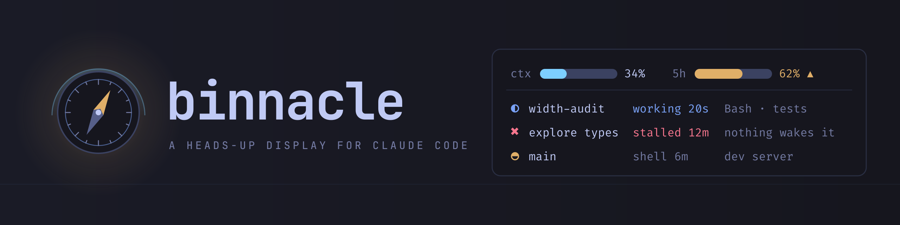
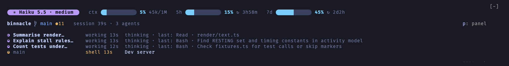

<div align="center">



**See what every agent is doing, right now.**

[](LICENSE)
[](https://code.claude.com/docs/en/plugins)
[](tsconfig.json)
[](tests)
[](i18n)

**v0.1.0** · Alpha

</div>

---

When a Claude Code session runs a dozen subagents, a workflow and a few background shells at
once, the transcript stops telling you who is doing what. binnacle draws a band above the prompt
with one row per agent, workflow, shell and other session: how it stands, since when, and what it
is doing at this moment.

<p align="center">
  
</p>

<p align="center"><sub>A live session: three subagents at work, each with the last call it made, and a background shell.</sub></p>

*binnacle*: the housing in front of a ship's helm that holds the compass, lit at night so the
helmsman can read it at a glance.

## Quick start

At the prompt of a Claude Code session:

```
/plugin install binnacle --marketplace Arakiss/binnacle
```

Answer `y` to add the marketplace, then pick a scope. Or from a shell:

```bash
claude plugin install binnacle --marketplace Arakiss/binnacle
```

The band appears above the prompt in the next session. Press `p` (or run `/binnacle`) for the
status pane. The band uses a few [Nerd Font](https://www.nerdfonts.com/) glyphs; any Nerd Font
in your terminal covers them.

## What it shows

| Part | What you get |
|---|---|
| **Budgets** | Model and effort, the context window, the five-hour and weekly quotas as gauges. A quota you burn faster than the clock turns amber; one that will run out before it resets says when. |
| **Where you are** | Repository, branch, uncommitted and unpushed work, the pull request and its checks, how long the session has run. |
| **A row per agent and shell** | Working, waiting, stalled, unknown or done, with the call it is making now. A workflow's agents share one row under the workflow's name; a shell whose output stopped changing says so. |
| **Stalls** | An agent that goes idle with nothing left that will wake it is marked stalled, told once before it idles, and can wake the main loop with a note (`/binnacle wake on`). |
| **Alerts** | Failing CI, actions denied this turn, other sessions writing in the same checkout. |
| **Status pane** | The turn's calls with their results, each refusal with its reason, agents and shells, pull request and CI, usage with sparklines, compactions, edited files and loaded skills. |

## Why binnacle

Claude Code shows the agents it runs as a list you open, and a background shell as a count under
the prompt. binnacle keeps the whole crew on screen while you type:

- **Liveness, not just presence.** An agent listed as idle may be waiting on a message that will
  come, on a shell whose end will never wake it, or on nothing at all. binnacle tells these apart
  and says which one stalled.
- **Its own words.** Each row reads in the call's own description ("Measure the band at 40
  columns"), not a tool id.
- **Nothing to configure.** No settings file to edit, no script to run beside it: install it and
  the band is there. With the band off it pins a one-line summary under the prompt instead.

## Commands

| Command | What it does |
|---|---|
| `/binnacle` | Opens or closes the status pane |
| `/binnacle band on\|off` | Draws above the prompt, or pins a one-line summary under it instead |
| `/binnacle line full\|compact\|hidden` | How much that summary line shows |
| `/binnacle wake on\|off` | Whether a stalled agent wakes the main loop with a note |
| `/binnacle reap` | Ends orphaned Codex loops (with `watchCodexLoops` on) |

With a `language` set, the command also takes that dictionary's words (`/binnacle línea corta`,
`/binnacle banda no` in Spanish); the English ones always work.

## Options

Set them in the plugin's settings (`/plugin`, then binnacle):

| Option | Default | What it does |
|---|---|---|
| `language` | `en` | The language binnacle speaks: `en`, `es`, or any dictionary you add |
| `peersCommand` | empty | A command that lists your other sessions, so each gets a row |
| `watchCodexLoops` | off | Flags Codex app-server wrapper loops left behind by Zentty and offers to end them |
| `hideModeHint` | off | Drops the permission-mode reminder from the hint under the prompt |

### Language

Every word binnacle draws comes from a JSON dictionary under `i18n/`. English is the default and
Spanish ships with it: set `language` to `es`. To add a language, copy `i18n/en.json` to
`i18n/<code>.json` and translate the values, keeping the `{placeholders}`. binnacle reads that
file when a session starts, and a key it leaves out falls back to English. `bun tools/i18n.ts`
builds the dictionaries in, and `--check` verifies that they are complete.

### Other sessions

binnacle can give each of your other live sessions a row. Point `peersCommand` at any command
that prints a JSON array of sessions:

```json
[
  {
    "session": "b1c2d3e4",
    "display_name": "Vesper",
    "harness": "claude-code",
    "cwd": "/home/you/shop",
    "repo": "/home/you/shop",
    "branch": "main",
    "intent": "Vesper: syncing the docs site",
    "liveness": "live",
    "lifecycle": "active",
    "last_ms": 1793000000000
  }
]
```

Only `session` is required. A session is named by its `display_name`; without one, by the name
an `intent` opens with (a capitalised word and a colon); without either, by its harness and the
last four characters of its id. Sessions with `liveness: "live"` get a row; a `lifecycle` other
than `active` is left out.
The command runs without a shell, split on spaces, every ten seconds.

## For scripts

`bun tools/liveness.ts` prints the same verdicts for the latest session, one row per agent and
shell (`--json` for one object per row), and exits with code 3 while an agent is stalled.

## Development

```bash
claude --plugin-dir /path/to/binnacle    # a session with this checkout loaded
claude plugin test .                     # the test suite
claude plugin validate .
bun tools/i18n.ts --check                # dictionaries complete and built
bun tools/preview.ts 120 band            # draw every fixture at 120 columns
```

The banner is `assets/banner.svg`; rebuild the PNG with
`rsvg-convert -w 2560 assets/banner.svg -o assets/banner.png`.

## License

[MIT](LICENSE)
