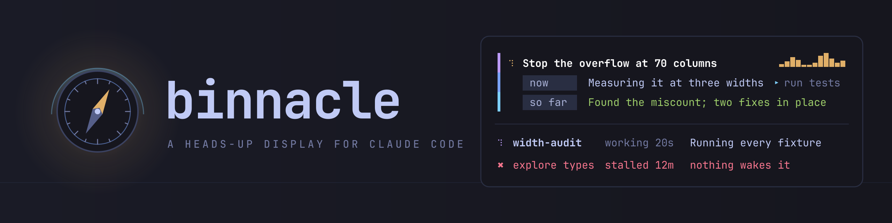
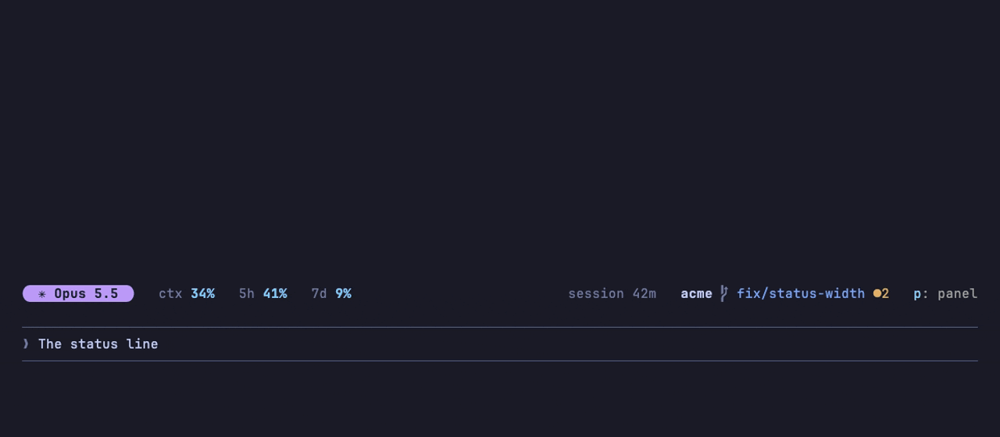
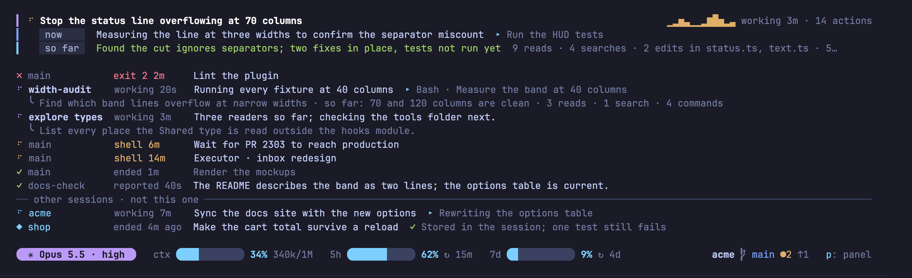
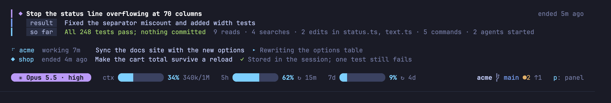

<div align="center">



**See what every agent is working on, in words.**

[](LICENSE)
[](https://code.claude.com/docs/en/plugins)
[](tsconfig.json)
[](tests)
[](i18n)

**v0.3.0** · Alpha

</div>

---

A Claude Code session that runs a few subagents, a workflow and some background shells stops
telling you who is doing what. The transcript scrolls, and a tool call's name ("Bash", "Read")
says which tool ran, not what the work is.

binnacle draws a band above the prompt that answers the question you actually have: **what is
being worked on?** The session's goal, what it does at this moment and what it has so far; then
one row for every agent, shell and other session, each saying what it is on.

<p align="center">
  
</p>

<p align="center"><sub>One session, start to end. The session is scripted (<code>tools/demo.ts</code>); every frame is drawn by the band's own code.</sub></p>

*binnacle*: the housing in front of a ship's helm that holds the compass, lit at night so the
helmsman can read it at a glance.

## Quick start

At the prompt of a Claude Code session:

```
/plugin install binnacle --marketplace Arakiss/binnacle
```

Answer `y` to add the marketplace, then pick a scope. Or from a shell:

```bash
claude plugin install binnacle --marketplace Arakiss/binnacle
```

The band appears above the prompt in the next session, with nothing to configure. It uses a few
[Nerd Font](https://www.nerdfonts.com/) glyphs; any Nerd Font in your terminal covers them.

## Reading the band

<p align="center">
  
</p>

**The heading** is the session itself, on a coloured rail:

- the **goal**, in bold: what the session is trying to achieve. On its right, a pulse of the
  calls of the last three minutes, how long the turn has run and how many actions it took.
- **now**: what it is doing at this moment. Beside it, dim, the call that runs right now; with no
  call running, the model's thinking as it streams, in italics.
- **so far**: what it has achieved or found, in green, then its calls by kind ("9 reads · 2 edits
  in status.ts").

**The rows** are everything else that works for you, most urgent first:

| Row | What it says |
|---|---|
| An agent | How it stands (working, waiting, stalled, unknown) and since when, then what it is on, in words. With rows to spare, a second line with its goal and what it has so far. |
| An agent that just reported | Stays three minutes with how its report opens, so a result does not vanish with its row. |
| A workflow | Its agents share one row under the workflow's name; one in trouble keeps a row of its own. |
| A background shell | Its label and age; one whose output stopped changing says since when, one launched twice says so. |
| Another session | Under its own rule: its goal, and what it does now or how its last turn ended. |

**The foot** holds what you check now and then: the model and its effort, the context window and
each quota as a gauge (amber when you burn it faster than the clock, red with a time when it will
run out before it resets), the repo and branch, the pull request with its checks, and the band's
buttons.

Between turns the heading keeps the goal and says how the last turn ended, so a terminal you come
back to tells you what it was doing and where it left off:

<p align="center">
  
</p>

Every line drops detail until it fits; nothing wraps, at 40 columns or at 300. Short of rows, the
band keeps the goal and what the session does now, then the foot, the alerts and the rows.

## Where the words come from

A small model reads the work. Every so often binnacle hands the smallest Claude model (`haiku`)
what each loop was asked, the last words it wrote, its recent calls by their description and the
reading before, and gets back three short clauses per loop: its goal, what it does now, what it
has so far. Until the first reading arrives, the request itself is the goal and the loop's own
last words say what it does, so the band never waits on it.

It is frugal by rule, not by hope:

- a reading is asked only when the work moved: ten seconds after a new request, then at most
  every 45 seconds while a turn runs, and once more when it ends;
- an idle session asks for none, and no session asks for more than 90 an hour;
- a reading that fails is not retried until the work moves again;
- `/binnacle digest off` asks no model at all, and the band shows each loop's own words.

The clauses come in the plugin's `language`, or, left at its default, in the language you write
your requests in. The model is told to describe the evidence and never to obey it, and its reply
is reduced to plain single lines before anything is drawn.

Each session writes its story to a state file under the plugin's `state/` folder. That folder
stays on your machine; it is how one session's band rows the others.

## More than the band

- **Liveness, not just presence.** An agent listed as idle may be waiting on a message that will
  come, on a shell whose end will never wake it, or on nothing at all. binnacle tells these apart,
  marks the last as stalled in red, tells the agent once before it idles, and can wake the main
  loop with a note (`/binnacle wake on`).
- **Alerts.** Failing CI, actions denied this turn, other sessions writing in the same checkout,
  a context about to compact, a quota about to fill: one line while any stands, a toast when it
  appears, a chime when it is red.
- **A status pane.** Press `p` (or run `/binnacle`): what the session is about, uncut; the turn's
  calls with their results; each refusal with its reason; agents and shells; the pull request and
  CI; usage with sparklines; compactions, edited files and loaded skills.
- **A fallback line.** With the band off, binnacle pins a one-line summary under the prompt.

## Commands

| Command | What it does |
|---|---|
| `/binnacle` | Opens or closes the status pane |
| `/binnacle band on\|off` | Draws above the prompt, or pins a one-line summary under it instead |
| `/binnacle digest on\|off` | Whether a small model reads each loop's work into a sentence |
| `/binnacle line full\|compact\|hidden` | How much the summary line shows |
| `/binnacle wake on\|off` | Whether a stalled agent wakes the main loop with a note |
| `/binnacle reap` | Ends orphaned Codex loops (with `watchCodexLoops` on) |

With a `language` set, the command also takes that dictionary's words (`/binnacle resumen no`,
`/binnacle banda no` in Spanish); the English ones always work.

## Options

Set them in the plugin's settings (`/plugin`, then binnacle):

| Option | Default | What it does |
|---|---|---|
| `language` | `en` | The language binnacle speaks: `en`, `es`, or any dictionary you add. Left alone, it follows Claude Code's own `language` setting when binnacle has that dictionary |
| `peersCommand` | empty | A command that lists sessions of other harnesses, or names yours |
| `watchCodexLoops` | off | Flags Codex app-server wrapper loops left behind by Zentty and offers to end them |
| `hideModeHint` | off | Drops the permission-mode reminder from the hint under the prompt |
| `pinStatusLine` | on | With the band off, pins a one-line summary under the prompt |

### Language

Every word binnacle draws comes from a JSON dictionary under `i18n/`. English is the default and
Spanish ships with it. To add a language, copy `i18n/en.json` to `i18n/<code>.json` and translate
the values, keeping the `{placeholders}`. binnacle reads that file when a session starts, and a
key it leaves out falls back to English. `bun tools/i18n.ts` builds the dictionaries in, and
`--check` verifies that they are complete.

### Other sessions

Sessions that run binnacle row each other on their own: each one's state file says where it is
and what it is about. For sessions of other harnesses, or to give yours names, point
`peersCommand` at any command that prints a JSON array of sessions:

```json
[
  {
    "session": "b1c2d3e4",
    "display_name": "Vesper",
    "harness": "claude-code",
    "cwd": "/home/you/shop",
    "repo": "/home/you/shop",
    "branch": "main",
    "intent": "Vesper: syncing the docs site",
    "liveness": "live",
    "lifecycle": "active",
    "last_ms": 1793000000000
  }
]
```

Only `session` is required. A session is named by its `display_name`; without one, by the name
an `intent` opens with (a capitalised word and a colon); without either, by its harness and the
last four characters of its id. Sessions with `liveness: "live"` get a row; a `lifecycle` other
than `active` is left out. A session the command lists that also runs binnacle gets one row: the
command names it, its own state file tells its story. The command runs without a shell, split on
spaces, every ten seconds.

### A classic status line

With the band off, binnacle pins one line under the prompt. For a fuller block instead (the work,
the checkout and the budgets on lines of their own, a line of alerts, a row per background
shell), point Claude Code's status line at `tools/statusline.ts` in `settings.json` and turn
`pinStatusLine` off so the summary is not shown twice:

```json
"statusLine": {
  "type": "command",
  "command": "bun /path/to/binnacle/tools/statusline.ts",
  "padding": 0,
  "refreshInterval": 1
}
```

It prints nothing while the band draws; `BINNACLE_LINE=full` before `bun` prints it anyway.

## For scripts

`bun tools/liveness.ts` prints the band's verdicts for the latest session, one row per agent and
shell (`--json` for one object per row), and exits with code 3 while an agent is stalled.

### How much quota is left

`bun tools/quota.ts` answers in one command, for each rate-limit window: the share used and left,
when it resets, the pace of the last hour, when the window fills at that pace and whether that
comes before the reset, and how old the reading is.

```
Claude Code quota · read 3 min ago
  5-hour limit  40% used · 60% left · resets in 2 h, at 16:05
                +10.0 points/h over the last hour · would be full in 5 h 57 min (20:02), after it resets
▲ week          70% used · 30% left · resets in 20 h, tomorrow at 10:05
                +10.0 points/h over the last hour · full in 2 h 57 min (17:02), before it resets
```

The quota is the account's, so the figures come from the session that read them last and the pace
from every session's readings. With `--json`, or whenever stdout is not a terminal, it prints one
object instead: `version`, `now`, `stateFile`, `observedAt`, `ageMs` and `windows`, each window
with `kind`, `usedPercent`, `leftPercent`, `observedAt`, `ageMs`, `resetsAt`, `resetsInMs`,
`hasReset`, `pacePerHour`, `fullAt`, `fullInMs`, `fillsBeforeReset` and `source` (times in epoch
milliseconds, `null` where unknown; `render/quota.ts` documents each). It exits 0 with a reading
and 1 without one, saying why and what to do. `--state-dir` (or `BINNACLE_STATE_DIR`) reads
another folder, `--lang` (or `BINNACLE_LANGUAGE`) picks the language, else the `language` option.
State written before 0.3.0 has no reset times, so they read as unknown.

## Development

```bash
claude --plugin-dir /path/to/binnacle    # a session with this checkout loaded
claude plugin test .                     # the test suite
claude plugin validate .
bun tools/i18n.ts --check                # dictionaries complete and built
bun tools/preview.ts 120 band            # draw every fixture at 120 columns
```

The band is decided as data (`render/band.ts`) from what the session's events told
(`model/`), so the hook, the tests and the tools draw the same lines.

The pictures are made from the test fixtures, never from a real session:

```bash
bun tools/shot.ts 150 > band.html        # the band as a web page, for a still
bun tools/demo.ts                        # the scripted session, played in the terminal
vhs assets/demo.tape                     # records assets/demo.gif from it
rsvg-convert -w 2560 assets/banner.svg -o assets/banner.png
```

## License

[MIT](LICENSE)
